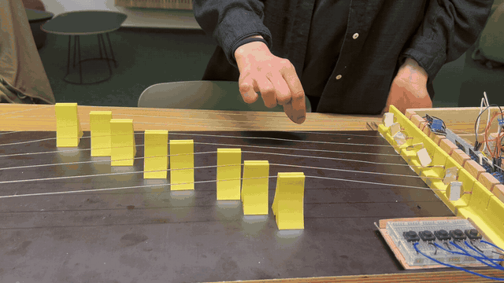
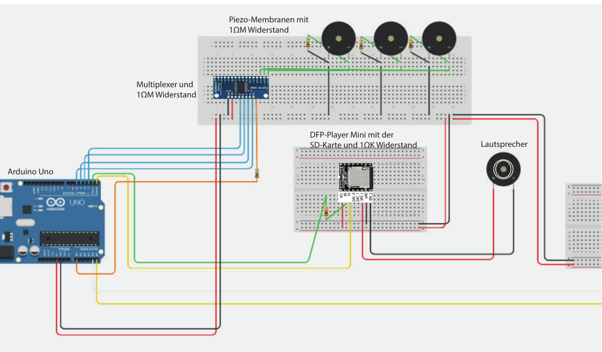

# PolyZheng ist ein digitales Saiteninstrument mit Arduino

PolyZheng ist ein selbstgebautes Saiteninstrument nach dem Vorbild der chinesischen Guzheng. Sensoren erkennen, ob eine Saite berührt oder gezupft wird, und ein Arduino spielt den passenden Ton ab. Per Knopfdruck wechselt man zwischen Guzheng, Erhu und Geige, und zusätzlich spielen vier weitere Knöpfe Tiergeräusche ab, um das Spielen unterhaltsamer zu machen.

Dies ist ein Gruppenprojekt im Wahlpflichtfach Prototyping an der Hochschule RheinMain aus dem Sommersemester 2025.




**Video mit Ton:** [docs/polyzheng-demo.mp4](docs/polyzheng-demo.mp4)

---

## Gruppenprojekt

Das Projekt ist zu dritt entstanden, und wir haben alle Teile gemeinsam umgesetzt: Sensoren aufbauen und an den Saiten befestigen, die Software programmieren und das Gehäuse bauen.

---

## So funktioniert es

| Komponente | Aufgabe |
|------------|---------|
| **Piezo-Membranen** | erkennen die Vibration beim Zupfen direkt an den Saiten |
| **MPR121 (kapazitiver Touchsensor, I²C)** | erkennt, ob eine Saite berührt wird |
| **Multiplexer (16 Kanäle)** | bündelt die Piezo-Signale, weil der Arduino zu wenige Analog-Eingänge hat |
| **Arduino Uno R3** | wertet die Sensoren aus und steuert die Tonausgabe |
| **DFPlayer Mini + Lautsprecher** | spielt die Töne von einer SD-Karte ab (serielle Schnittstelle) |

**Spielweise:**
- **Berühren** einer Saite spielt einen leisen Ton, **langes Berühren** einen lauten.
- **Zupfen** spielt einen lauten Ton. Ein Schwellenwert verhindert, dass schon kleinste Vibrationen einen Ton auslösen.
- Der **Modus-Knopf** wechselt zwischen Guzheng, Erhu und Geige.



---

## Vom Prototyp zum Instrument

Wir haben in **drei Prototypen** gearbeitet: von Pappe und Pfeifenputzern als Saiten über ein stabileres Modell bis zum fertigen Instrument aus Holz mit echten Stahlsaiten, Gitarren-Mechaniken und **3D-gedruckten** Saitenhaltern, Brücken und Standfüßen.

Die größten Herausforderungen:
- **Piezo-Sensoren** reagieren schon auf kleinste Vibrationen. Lösung: viele Messreihen und ein sorgfältig gewählter Schwellenwert.
- **Zu wenige Analog-Eingänge** am Arduino. Lösung: ein Multiplexer.
- **Saiten dürfen sich nie berühren**, sonst stört das den Touchsensor. Lösung: genaue Abstände in den 3D-gedruckten Saitenhaltern.

Die ausführliche Bauanleitung mit Testschaltungen, Code-Beispielen und häufigen Fehlern steht in **[docs/anleitung.md](docs/anleitung.md)**.

---

## Projektstruktur

```
├── PolyZheng/PolyZheng.ino     # finaler Arduino-Code
├── tests/testCode/testCode.ino # Testcode für die Sensoren
└── docs/                       # Anleitung, Schaltplan, GIF und Video
```

## Code ausführen

1. `PolyZheng/PolyZheng.ino` in der **Arduino IDE** öffnen.
2. Benötigte Bibliotheken installieren:
   - [DFRobotDFPlayerMini](https://github.com/DFRobot/DFRobotDFPlayerMini)
   - [Grove Touch Sensor MPR121 (Seeed)](https://github.com/linux-downey/Grove_touch_sensor_MPR121)
3. Auf einen Arduino Uno hochladen. Die Tondateien gehören auf die SD-Karte des DFPlayer Mini.
